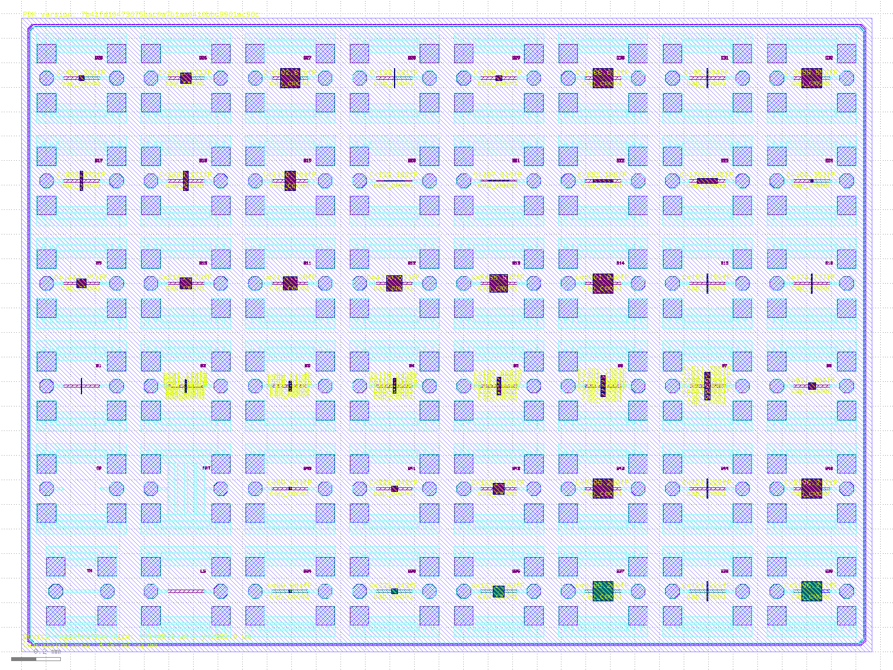
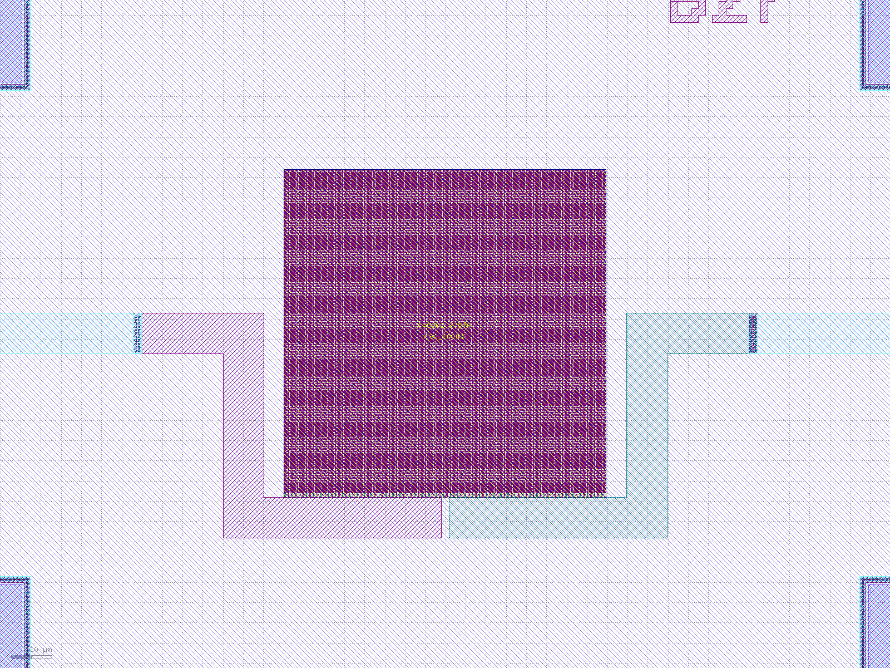

# SG13CMOS5L cap_cmomi Capacitor Test Structures (TEST3283)

<!-- Generated by TEST3283-main/layout/klayout/scripts/doc_tables.py render from doc_templates/README.md.in
     and slots.csv. Edit those, not this file. -->

Test chip for characterising `cap_cmomi`, the interdigitated MoM capacitor of the ihp-sg13cmos5l PDK.
It is a twin of [TEST9203](https://github.com/KrzysztofHerman/IHP__TEST9203), which characterises `cap_cmomf`.
Frame, pads, ground straps, open/short/through structures and sealring are identical (3465 x 2582 um). The
devices under test change: every `cap_cmomf` is replaced by a `cap_cmomi` generated with the PDK pycell
(IHP-Open-PDK `dev`, commit `7b41fd10`), and the second open of TEST9203 becomes a lead short.

## Tiles and pads

The chip holds 8 x 6 two-port GSG-GSG tiles on a 425 x 418 um pitch, with the device in series between the
two signal pads. Pads are 60 um signal octagons and 80 um ground squares on TopMetal1, GSG pitch 100 um, and the
two signal pads of a tile are 285 um apart. In every tile the **left signal pad is PLUS** and the **right signal
pad is MINUS** of `cap_cmomi` (texts `c1` and `c2` on Metal4).

Tile `Bk` sits where TEST9203 has `Ak`, so the two chips can be compared tile by tile. Rows count from the
bottom of the chip, columns from the left.

| row \ col | 0 | 1 | 2 | 3 | 4 | 5 | 6 | 7 |
| --- | --- | --- | --- | --- | --- | --- | --- | --- |
| 5 | B25 | B26 | B27 | B28 | B29 | B30 | B31 | B32 |
| 4 | B17 | B18 | B19 | B20 | B21 | B22 | B23 | B24 |
| 3 | B9 | B10 | B11 | B12 | B13 | B14 | B15 | B16 |
| 2 | B1 | B2 | B3 | B4 | B5 | B6 | B7 | B8 |
| 1 | OP (open) | SHT (short) | B40 | B41 | B42 | B43 | B44 | B45 |
| 0 | TH (not usable) | LS (lead short) | B34 | B35 | B36 | B37 | B38 | B39 |

## Calibration

The calibration structures sit in the bottom left corner. `OP` (open), `SHT` (short) and `TH` (through)
are copied from TEST9203 without changes. `TH` has its pads at +-105 um instead of +-142.5 um, so it is
not on the DUT reference plane and is not usable for de-embedding. Use `OP` and `SHT` (open-short).

`LS` (lead short, row 0, col 1) replaces the second open `A33` of TEST9203. It is the DUT fixture with a
Metal4 bar, 10 um wide, between the two landing patches. Open-short de-embedding puts the reference plane at
the end of the TopMetal1 stubs, so the landing patches and the leads to the device stay inside every DUT
measurement. `LS` measures their series resistance and inductance, which matter for the ESR and Q of the
capacitors. See [measurement/README.md](./measurement/README.md).

## Devices

Sizes are `l` (finger length, along X) by `w` (along Y, rows of 0.89 um) in um. `feed` is the pycell
terminal style: `double` has PLUS and MINUS bars on opposite sides of the cell, `same` has both on the left,
stacked (PLUS on the top metal, MINUS one metal below). Arrays (`Copies` > 1) are stacked in Y with a 1 um gap,
mirrored so that facing bars share a net, and connected in parallel. The model values come from the PDK
model (`libs.tech/ngspice/models/cap_cmomi.lib`) and do not include the leads inside the tile
(`TEST3283-main/layout/klayout/leads.csv` lists them per tile).

The `same` feed cells are turned 90 degrees so that their stacked pad (PLUS on the top metal over MINUS
one metal below) runs along the bottom of the cell. Each net touches the pad with a 5 um tab near its
centre (PLUS left of centre, MINUS right, 2 um apart; on B24 the tabs reach the pad ends, 4.1 um). The lead
bars run 3 um below the pad, so only the tabs face the opposite net. Each lead runs down, out and up a riser
5 um beside the cell to its landing patch. No lead crosses
or encloses the device and the two leads do not overlap. These leads are longer than the `double` ones and
are not covered by `LS`: use `leads.csv` (and the EM bench) to subtract them.

| Tile | l (um) | w (um) | Stack | Feed | Copies | C model, total (fF) |
| --- | ---: | ---: | --- | --- | ---: | ---: |
| B1 | 2 | 2 | M1-M4 | double | 19 | 68.3 |
| B2 | 4.9 | 4.9 | M1-M4 | double | 9 | 190.0 |
| B3 | 7.8 | 7.8 | M1-M4 | double | 5 | 299.1 |
| B4 | 10.7 | 10.7 | M1-M4 | double | 5 | 595.1 |
| B5 | 13.6 | 13.6 | M1-M4 | double | 5 | 988.3 |
| B6 | 16.4 | 16.4 | M1-M4 | double | 5 | 1406.0 |
| B7 | 22.2 | 22.2 | M1-M4 | double | 5 | 2559.0 |
| B8 | 28 | 28 | M1-M4 | double | 1 | 837.9 |
| B9 | 36.7 | 36.7 | M1-M4 | double | 1 | 1442.2 |
| B10 | 45.3 | 45.3 | M1-M4 | double | 1 | 2166.3 |
| B11 | 54 | 54 | M1-M4 | double | 1 | 3137.3 |
| B12 | 62.7 | 62.7 | M1-M4 | double | 1 | 4230.6 |
| B13 | 71.3 | 71.3 | M1-M4 | double | 1 | 5486.9 |
| B14 | 80 | 80 | M1-M4 | double | 1 | 6901.9 |
| B15 | 2 | 80 | M1-M4 | double | 1 | 157.2 |
| B16 | 5 | 80 | M1-M4 | double | 1 | 374.7 |
| B17 | 10 | 80 | M1-M4 | double | 1 | 809.9 |
| B18 | 20 | 80 | M1-M4 | double | 1 | 1680.2 |
| B19 | 40 | 80 | M1-M4 | double | 1 | 3420.8 |
| B20 | 80 | 2 | M1-M4 | double | 1 | 155.2 |
| B21 | 80 | 5 | M1-M4 | double | 1 | 387.8 |
| B22 | 80 | 10 | M1-M4 | double | 1 | 853.1 |
| B23 | 80 | 20 | M1-M4 | double | 1 | 1706.2 |
| B24 | 10 | 10 | M1-M4 | same | 1 | 100.3 |
| B25 | 20.5 | 20.5 | M1-M4 | same | 1 | 453.3 |
| B26 | 44 | 44 | M1-M4 | same | 1 | 2083.6 |
| B27 | 80 | 80 | M1-M4 | same | 1 | 6902.9 |
| B28 | 2 | 80 | M1-M4 | same | 1 | 158.1 |
| B29 | 22.2 | 22.2 | M3-M4 | double | 1 | 259.9 |
| B30 | 80 | 80 | M3-M4 | double | 1 | 3488.6 |
| B31 | 2 | 80 | M3-M4 | double | 1 | 85.3 |
| B32 | 80 | 80 | M3-M4 | same | 1 | 3489.6 |
| B34 | 10.7 | 10.7 | M1-M3 | double | 1 | 90.0 |
| B35 | 22.2 | 22.2 | M1-M3 | double | 1 | 385.8 |
| B36 | 45.3 | 45.3 | M1-M3 | double | 1 | 1631.4 |
| B37 | 80 | 80 | M1-M3 | double | 1 | 5195.3 |
| B38 | 2 | 80 | M1-M3 | double | 1 | 121.2 |
| B39 | 80 | 80 | M1-M3 | same | 1 | 5196.2 |
| B40 | 10.7 | 10.7 | M2-M4 | double | 1 | 90.0 |
| B41 | 22.2 | 22.2 | M2-M4 | double | 1 | 385.8 |
| B42 | 45.3 | 45.3 | M2-M4 | double | 1 | 1631.4 |
| B43 | 80 | 80 | M2-M4 | double | 1 | 5195.3 |
| B44 | 2 | 80 | M2-M4 | double | 1 | 121.2 |
| B45 | 80 | 80 | M2-M4 | same | 1 | 5196.2 |

The groups, in short:

- **B1-B14**: full stack, double feed, the same squares as TEST9203 A1-A6, A8, A10, A13, A16, A19, A22, A25
  and A28 (column `momf same size` in the Datasheet), for a direct comparison with `cap_cmomf` and the area law.
- **B15-B19 / B20-B23**: `l` sweep at `w` = 80 and `w` sweep at `l` = 80. They separate the per-length,
  per-row and feed terms of the anisotropic cell, which squares alone cannot.
- **B24-B28**: `same` feed. The PDK model fits this feed term on a different geometry than the drawn one.
- **B29-B32, B34-B39, B40-B45**: the reduced stacks M3-M4, M1-M3 and M2-M4, with size, strip and `same` points.

Per tile details are in [doc/Datasheet.md](./doc/Datasheet.md).

## Fill

The submitted GDS is filled with the PDK filler (Activ, GatPoly, Metal1-4, TopMetal1). Each device carries a
nofill keepout (device bounding box + 5 um) on all those layers. `OP`, `SHT` and `LS` carry the largest
device keepout, so the fill seen by the open is the fill seen by the devices. On the filled GDS the nearest fill
shape is at least 5 um from every device and calibration core (`scripts/check_fill.py`).

## Generator

Everything is generated from TEST9203. `TEST3283-main/layout/klayout/scripts/flow.sh` does the following:

1. Cuts the `cap_cmomf` devices out of the TEST9203 fixture.
2. Places and routes the `cap_cmomi` cells listed in `slots.csv`.
3. Checks connectivity and the fixture.
4. Fills and runs DRC.
5. Writes the release GDS.

See [TEST3283-main/README.md](./TEST3283-main/README.md).

## Verification

- DRC, full and min (with density) decks of the PDK, on the filled GDS: clean. Logs and databases are in
  [release/v.1.0.0/doc/DRC.md](release/v.1.0.0/doc/DRC.md). The min run is the foundry precheck.
- DRC on the nofill GDS: only the density and fill rules, the same set as TEST9203 nofill.
- Connectivity, all 44 tiles: PLUS, MINUS and ground are three separate nets, and both signal nets own the
  device fingers. `LS`: both signal pads on one net, separate from ground.
- Fixture: XOR against TEST9203 outside the device windows, no geometry difference. The only text
  changes are the PDK version and the sealring area line (8.94663 sq mm, was 8.9e-06 sq mm).
- Fill: no fill within 5 um of any device or calibration core.

## Tape out information

Not submitted yet.
